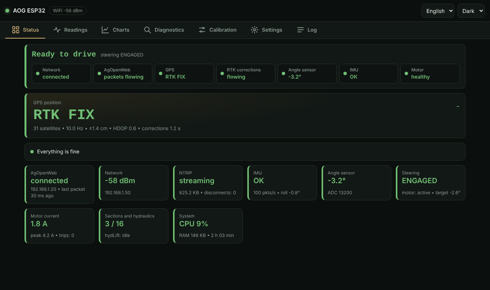

# AOW-Unified-ESP32

**Language / Język:** English · [Polski](README.pl.md)

[](LICENSE)


> ⚠️ **Read [SAFETY.md](SAFETY.md) before first use.** This steers a vehicle. It is not a certified safety product.
> Licensed under [GPL-3.0](LICENSE), provided without any warranty.

**One ESP32-S3 module that does autosteer, sections, hydraulics and GPS for [AgOpenWeb](https://github.com/AgOpenWeb)** -
with a live web panel, a built-in NTRIP client, an IMU and over-the-air updates. No app and no internet needed: the
panel is served by the module itself, in Polish and English.


<sub>Status tab. All screenshots and the wiring diagram in this repository were **generated by AI** from demo data, not taken from a real machine.</sub>

## Highlights

- **GPS + RTK:** LG290P at 10 Hz, automatic baud detection, non-blocking configuration, built-in NTRIP client with RTCM diagnostics.
- **Autosteer:** wheel-angle sensor, motor driver with P regulator, current protection, runaway detector, kick-out to AgOpenWeb.
- **Sections, hydraulic lift, tram lines** (pins set in AgOpenWeb) through an I²C expander (MCP23017).
- **IMU** BNO085 (roll/pitch/heading) with board-rotation correction.
- **Network:** up to 4 WiFi networks, own access point as fallback, phone-hotspot friendly (DHCP), optional Ethernet (W5500).
- **Web panel:** status, readings, 24 h charts stored by the module, diagnostics, calibration, settings, log. PIN/password protected changes.
- **Safe to update:** OTA from the Arduino IDE or the panel; refused while steering is engaged.
- **Tested:** host-side unit tests (`tools/run_tests.sh`) run on every push.

## AgOpenWeb version (hotspot / unicast)

Over a phone hotspot (random subnet, no usable broadcast) frames reach AgOpenWeb by **unicast**. The fork below
contains a corrected unicast for hotspots: **[kostek415contact-hash/AgOpenWeb](https://github.com/kostek415contact-hash/AgOpenWeb)**.
On a normal router (broadcast works) the stock version is fine.

## Quick start

1. **Arduino IDE** with the **ESP32 core 3.3.11** (the tested version); board **ESP32-S3**, PSRAM **OPI PSRAM**.
2. Install the libraries: *Adafruit ADS1X15*, *Adafruit MCP23X17*, *Adafruit NeoPixel*, *Adafruit BNO08x RVC* (tested: ADS1X15 2.6.2, MCP23017 2.3.2, NeoPixel 1.15.5, BNO08x RVC 1.0.2, BusIO 1.17.4).
3. *(Recommended)* copy `secrets.example.h` to `secrets.h` and set an AP and an OTA password (never committed to git).
4. Open `AOW-Unified-ESP32.ino` and upload. Or flash a ready binary from the **Releases** page.
5. Join the WiFi **`AOG-ESP32-Setup`**, open **http://192.168.4.1**, enter your WiFi in **Settings**, restart.

Details, screenshots and first calibration: **[docs/en/getting-started.md](docs/en/getting-started.md)**.

## Documentation

| | English | Polski |
|---|---|---|
| Getting started | [getting-started](docs/en/getting-started.md) | [pierwsze uruchomienie](docs/pl/getting-started.md) |
| Wiring and parts | [wiring](docs/en/wiring.md) | [okablowanie](docs/pl/wiring.md) |
| Pinout and ports | [pinout](docs/en/pinout.md) | [piny](docs/pl/pinout.md) |
| User guide (panel, calibration) | [user-guide](docs/en/user-guide.md) | [instrukcja](docs/pl/user-guide.md) |
| Troubleshooting | [troubleshooting](docs/en/troubleshooting.md) | [problemy](docs/pl/troubleshooting.md) |
| First start checklist | [first-start](docs/en/first-start.md) | [pierwszy start](docs/pl/first-start.md) |
| FAQ | [faq](docs/en/faq.md) | [faq](docs/pl/faq.md) |

Also: [SAFETY.md](SAFETY.md) · [SECURITY.md](SECURITY.md) · [CONTRIBUTING.md](CONTRIBUTING.md) · [CHANGELOG.md](CHANGELOG.md) ·
[ROADMAP.md](ROADMAP.md) (Polish).

## Hardware at a glance

| Module | Interface | Pin / address |
|---|---|---|
| GPS LG290P | UART1, 460800 | RX **GPIO4**, TX **GPIO5** |
| IMU BNO085 (UART-RVC) | UART2, 115200 | RX **GPIO6**, RST **GPIO7**, PS0 to 3.3 V |
| ADS1115 (angle ch0, current ch1) | I²C | SDA **GPIO8**, SCL **GPIO9**, `0x48` |
| MCP23017 (sections + hydLift) | I²C | `0x20`, pin functions from AgOpenWeb (Pin Config) |
| Cytron MD13S (motor) | PWM + DIR | **GPIO16** / **GPIO17** |
| W5500 Ethernet (optional) | SPI | CS 10, MOSI 11, SCK 12, MISO 13 |
| Steering button / work switch | inputs | **GPIO15** / **GPIO18** |
| Status LED WS2812 | 1 wire | **GPIO38** |

Full table, notes and network ports: [docs/en/pinout.md](docs/en/pinout.md). Wiring diagram: [docs/en/wiring.md](docs/en/wiring.md).

## Feature status

| Feature | Status |
|---|---|
| WiFi (up to 4 known networks) + own AP (fallback) | 🟢 works, confirmed in the field |
| Ethernet (W5500) | 🟡 option - switch it on in the panel (Settings → Ethernet) once wired; falls back to WiFi on failure |
| GPS 10 Hz, autobaud, retry after a late start | 🟢 works |
| Built-in NTRIP client (VRS) + RTCM diagnostics | 🟢 works, RTK FLOAT and FIX confirmed |
| IMU BNO085 | 🟢 works, 100 packets/s |
| Steering angle sensor | 🟢 works (calibration in the panel) |
| Machine outputs (sections, hydraulics, tram) | 🟡 follow the AgOpenWeb Pin Config, to verify on hardware |
| Web panel | 🟢 works |
| Motor + P regulator | 🟡 code ready, motor not yet fitted |
| Current sensor (ACS71240KEXBLT-030B3, ±30 A) | 🟡 wired, zero calibration and readout work; **not yet tested under motor load** |

## Repository layout

```
config/         config.h - ALL settings (pins, addresses, feature switches)
secrets.h       start-up passwords (outside git; template: secrets.example.h)
connectivity/   WiFi, PGNs sent and received, main loop (network_manager.h)
sensors/        GPS (non-blocking configuration FSM), IMU, angle sensor, current sensor
io/             button + switch, section expander (MCP23017), LED
actuators/      motor, hydraulics
ntrip/          built-in NTRIP client, RTCM relay from AgOpenWeb
web/            web panel (web_ui.h + ui/ = page in parts, web_server.h = server and /status), settings in NVS, log buffer, language catalogs
diagnostics/    watchdog, CPU profile, free-RAM trend, WiFi outage timing
ota/            over-the-air update
tests/          host-side unit tests (plain C++)
tools/          run_tests.sh, i18n_check.py, docs_check.py, log_extract.py
docs/           guides (en, pl) and images
```

## Rules we keep in the code

- `loop()` **never blocks** (no `delay()` / waiting in the loop).
- Diagnostics measure **time**, not loop iterations.
- Changes are made **one at a time**, each confirmed on hardware.
- Code and translation keys are English / neutral; Polish is just one language catalog (`web/lang/README.md`).

## Contributing, security, licence

- [CONTRIBUTING.md](CONTRIBUTING.md) - how to build, test and add a language
- [SECURITY.md](SECURITY.md) - reporting vulnerabilities
- [SAFETY.md](SAFETY.md) - **please read** before connecting this to a machine
- [LICENSE](LICENSE) - **GNU GPL v3.0**; distributed derivative works must be released under the same licence. No warranty.
