# User guide

[Polski](../pl/user-guide.md) · [Getting started](getting-started.md) · [Troubleshooting](troubleshooting.md) · [Back to README](../../README.md)

> Screenshots below were generated by AI from demo data.

The panel is a web page served by the module itself - no app and no internet needed. Open it at
`http://AOG-ESP32.local`, at the module's IP, or at `192.168.4.1` in access-point mode. The language (Polish / English)
and the theme (dark / light / blue) are picked in the page header.

Handy details: the panel reopens on the tab you used last. On every tab except Status a slim bar under the header shows
"Ready to drive" (or the first things that are not ready); tap it to open Status. The **A+** button in the header switches
field mode (larger buttons, inputs and tabs for use in a tractor cab); it is remembered in the browser. In Settings the
categories (Network, AgOpenWeb connection, ...) fold by tapping their title - only the first starts open - and the search box
at the top filters the settings by name or description; the last five cards you edited appear above them as shortcuts ("Recently edited"). On a phone, field mode makes the tab bar scroll sideways. The Log tab has **Diagnostic report** (download) and **Copy report** (to the clipboard, secrets hidden) for bug reports.

## On a computer, tablet and phone

The same panel adapts to the screen: on a computer the cards sit side by side, on a tablet in two columns, and on a phone the tabs move to the bottom of the screen. Pictures of every main tab:

<table>
<tr><th>Computer</th><th>Tablet</th><th>Phone</th></tr>
<tr><td colspan="3"><b>Status</b></td></tr>
<tr>
<td valign="top"></td>
<td valign="top">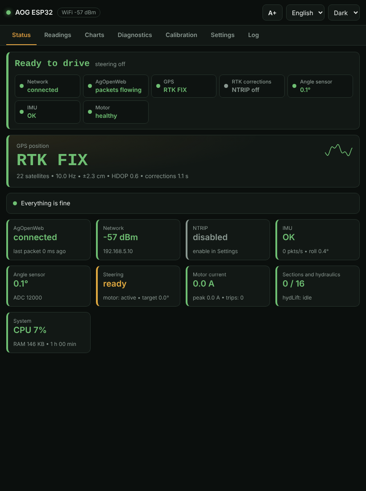</td>
<td valign="top">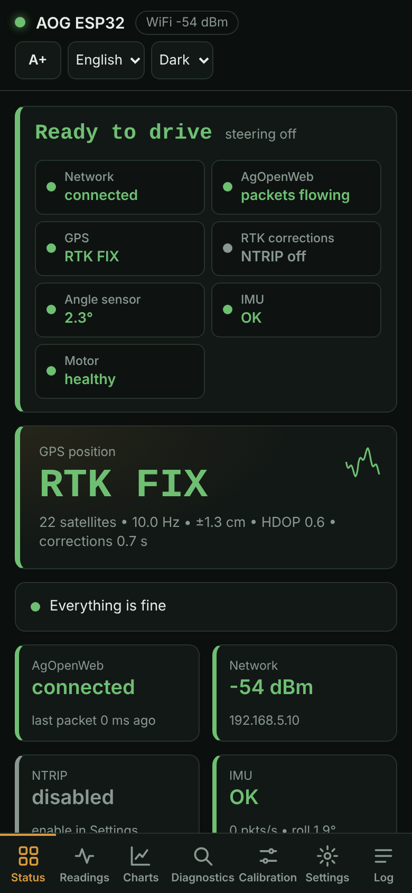</td>
</tr>
<tr><td colspan="3"><b>Readings</b></td></tr>
<tr>
<td valign="top">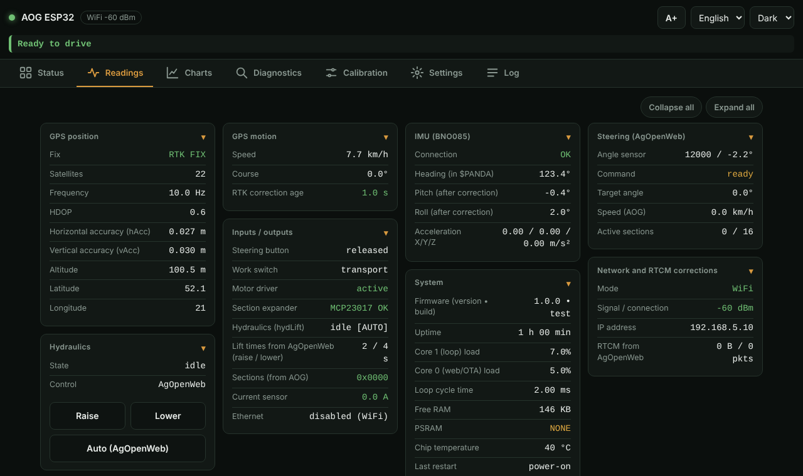</td>
<td valign="top">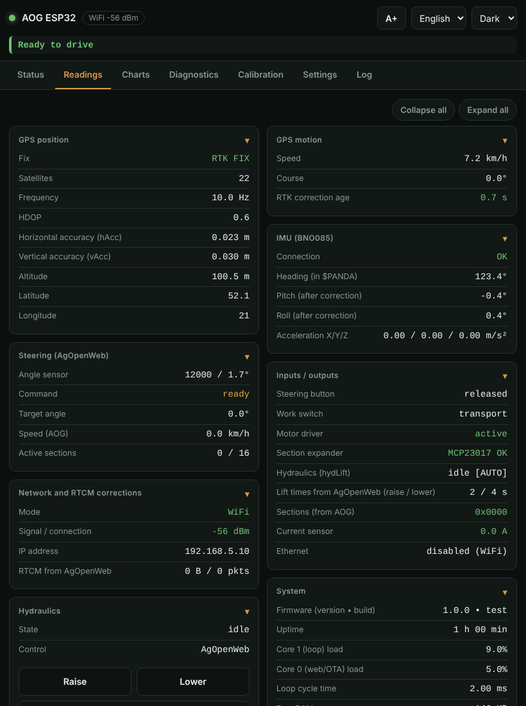</td>
<td valign="top">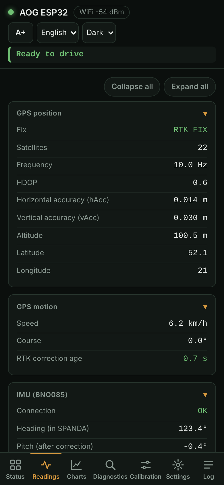</td>
</tr>
<tr><td colspan="3"><b>Charts</b></td></tr>
<tr>
<td valign="top">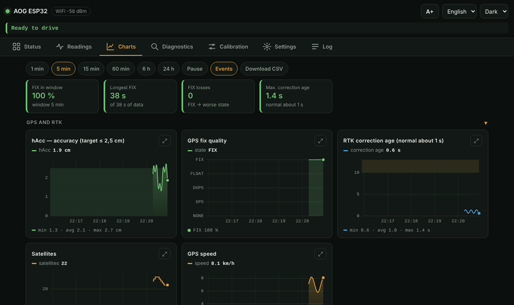</td>
<td valign="top">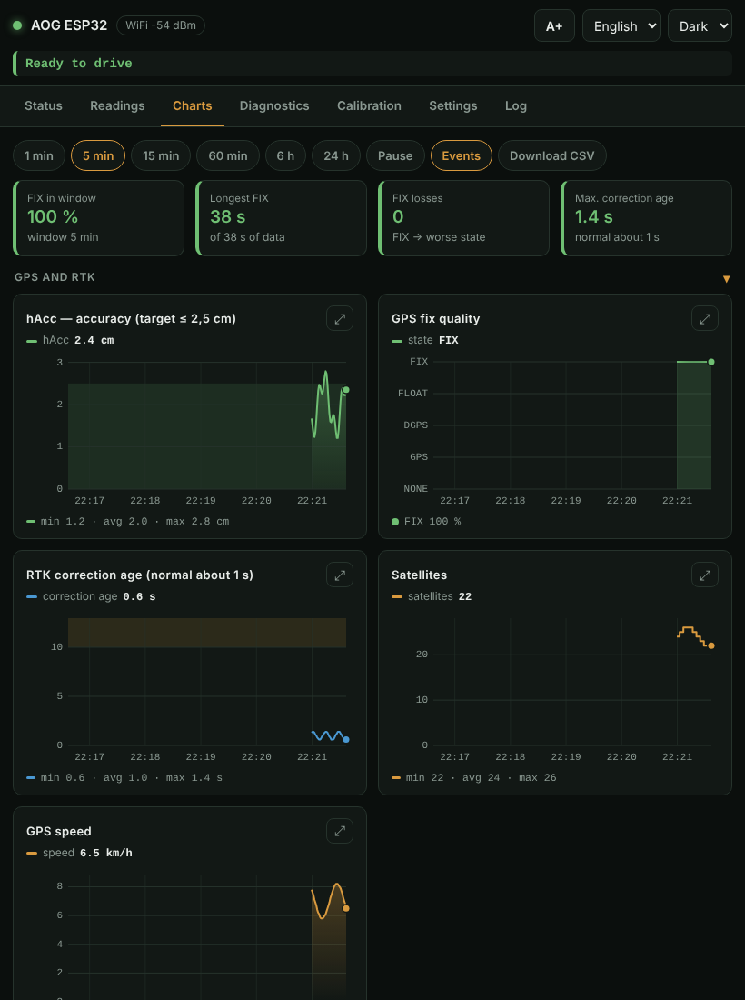</td>
<td valign="top">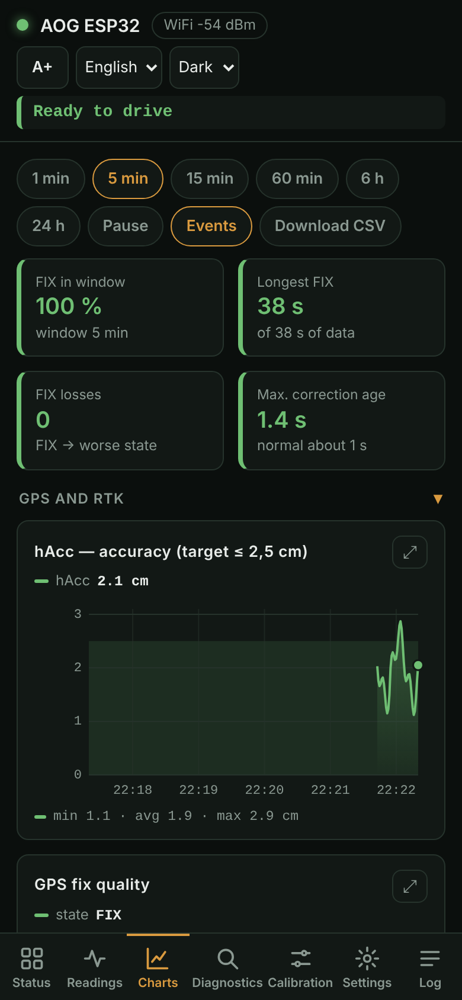</td>
</tr>
<tr><td colspan="3"><b>Calibration</b></td></tr>
<tr>
<td valign="top">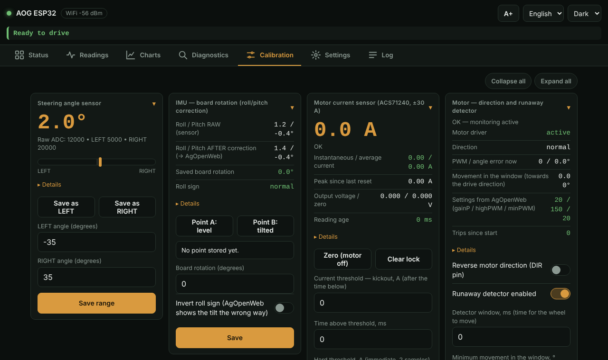</td>
<td valign="top">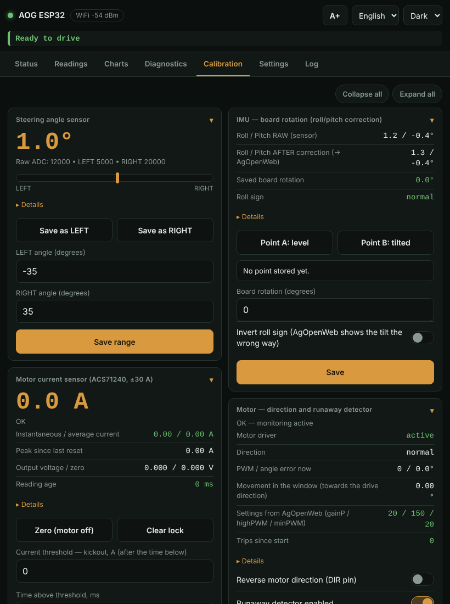</td>
<td valign="top">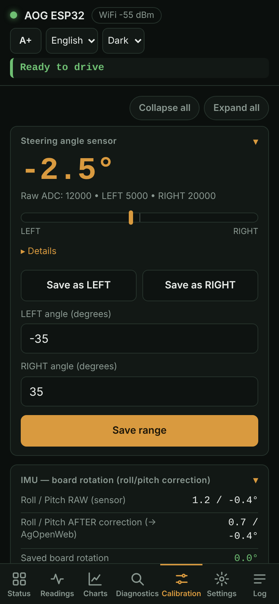</td>
</tr>
<tr><td colspan="3"><b>Settings</b></td></tr>
<tr>
<td valign="top">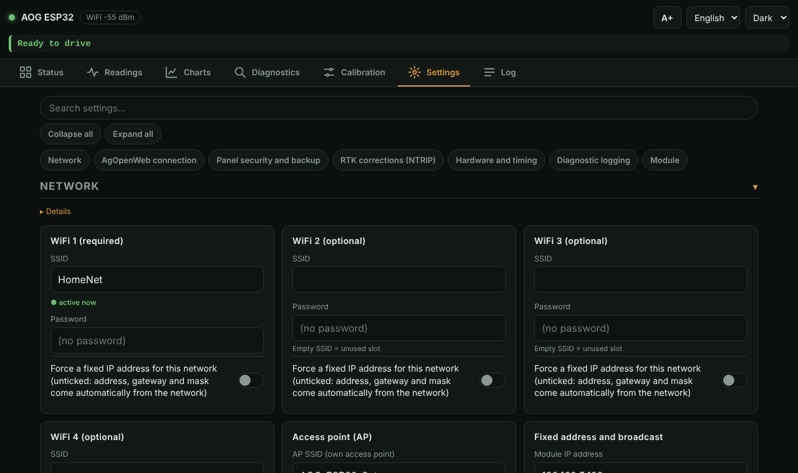</td>
<td valign="top">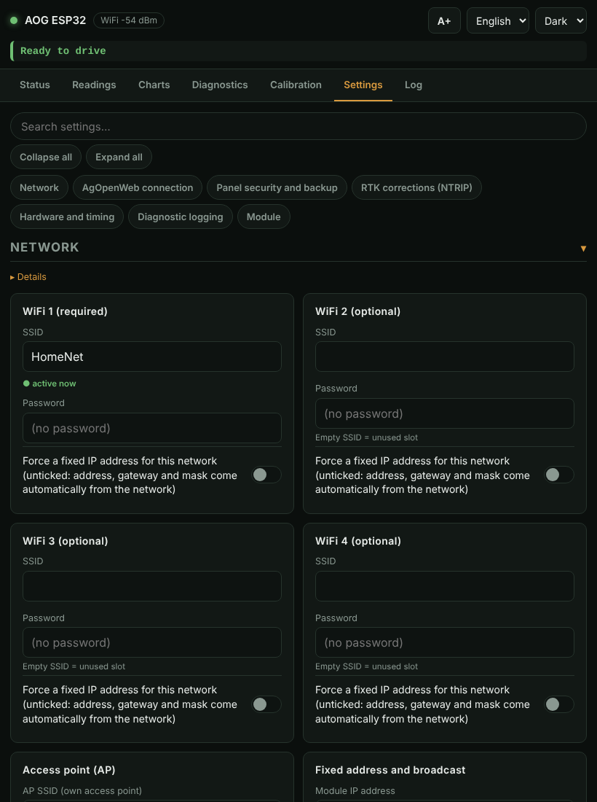</td>
<td valign="top">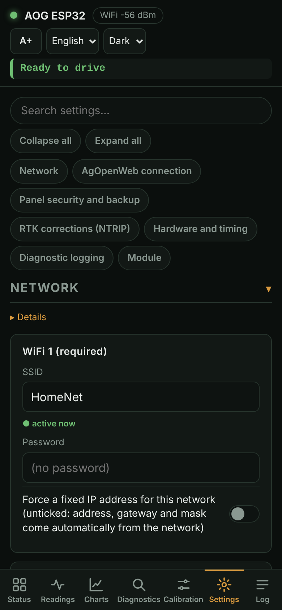</td>
</tr>
</table>

## Status

The first card says whether the machine is **ready to drive** and lists what still needs attention. Below it: the big
GPS/RTK fix and tiles for AgOpenWeb, network, NTRIP, IMU, angle sensor, steering, motor current, sections and the system.
Green = fine, amber = look at it, red = problem.

## Readings

Every live value in one place: GPS position and accuracy, speed and heading, inputs/outputs, IMU, the data AgOpenWeb sends
(target angle, speed, sections), network and RTCM, system load and memory. The **Hydraulics** card shows the lift state and
who controls it (AgOpenWeb or manual) and has the Raise / Lower / Auto buttons. Raise and Lower ask for confirmation; Auto
always works, and a restart always returns to automatic.

In Readings and Calibration a card folds when you tap its title; **Collapse all** / **Expand all** above the cards do it for the whole tab, and the browser remembers your choice. Long explanations everywhere are folded under **Details**.

## Charts

Live charts of fix quality, accuracy, correction age, satellites, speed, roll/pitch, steering angle, motor current, WiFi,
data flow, CPU and RAM, with ranges from 1 minute to 24 hours, pause, CSV export, a shared cursor and full screen. The
module keeps the history itself (in PSRAM), so charts fill up even with the page closed; it starts over after a restart.
This needs OPI PSRAM enabled when building. The vertical lines are events (fix change, steering on/off, restarts, network loss).

## Diagnostics

One card per subsystem. The switch in a card turns that subsystem's logging on **and** shows all its data (GPS
configuration result, WiFi outage times, free-RAM trend, PGN counters, ...). Use it when something misbehaves. Switched-on
cards line up first, in list order, at the top.

The **System** card also keeps counters that survive restarts: starts, abnormal restarts (crash, watchdog, power dip), motor
running time and protection trips (runaway, current, main loop hung and cut by the dead-man timer). Twenty seconds after every start the log holds one **self-check
line** (angle sensor, IMU, section expander, current sensor, GPS, network: OK / NO / off).

AgOpenWeb also shows short messages from the module on its screen: an abnormal restart (once, when AgOpenWeb is listening),
"Motor not armed - switch steering off and on" (repeated every 15 s while it lasts) and hardware faults.

## Calibration

**Angle sensor** (do this with the motor disconnected):
1. Turn the wheels fully left → **Save as LEFT**.
2. Turn the wheels fully right → **Save as RIGHT**.
3. Enter the real end-stop angles in degrees and **Save range**.

The motor stays blocked until **both** points have been saved at least once (a sensor that was never calibrated has no usable angle).
The calibration, motor, current-protection, range and feature settings cannot be changed while steering is engaged in AgOpenWeb -
the panel answers "Steering is engaged" - so disengage steering first.

**IMU board rotation** (corrects roll/pitch for a tilted mounting):
1. Mount the enclosure and put the machine level → **Point A**.
2. Tilt it sideways by 10-15° around the driving axis → **Point B**.
3. Enter the angle and **Save**. If AgOpenWeb shows the tilt the wrong way, tick **Invert roll sign** before saving.

**Motor current sensor:** with the motor off and steering disengaged press **Zero** (about 1-2 s of averaging). Then set the
current threshold (kick-out), its time and the hard limit to suit your motor, and **Save thresholds**.

**Motor direction and runaway detector:** the first time, disconnect the motor from the steering or lift the wheels. Engage
steering in AgOpenWeb with a target a few degrees from the current angle. If the wheel goes the wrong way, the detector
stops the motor within a fraction of a second; tick **Reverse motor direction (DIR pin)**, save and repeat. (Disengage steering first: settings cannot be saved while it is engaged.) No recompiling needed.

## Settings

The tab is split into titled sections - Network, AgOpenWeb connection, Panel security and backup, RTK corrections (NTRIP),
Hardware and timing, Diagnostic logging, Module - with buttons at the top to jump to one. Long explanations are folded under
"Details". On a phone every section can be folded by tapping its title, and only the first one starts open.

| Card | What it does |
|---|---|
| **Network** | up to 4 WiFi networks (empty password allowed), per-network fixed IP, the module's own access point, AgOpenWeb broadcast address. Needs a restart |
| **AgOpenWeb senders** | lists every AgOpenWeb program sending on the network. The module follows one (the first that spoke) and ignores the others; you can pin one permanently |
| **Steering engage detection** | which bit of the status byte means "engaged" |
| **NTRIP** | host, port, mountpoint, user and password of your correction service; passwords are never sent back to the page |
| **Features** | switch subsystems (section expander, motor, current sensor, IMU, LED) on or off. The lift, tram lines and geo-stop are not switches: they are pin functions chosen in AgOpenWeb (Machine → Pin Config). The motor driver and the current sensor apply at once; the section expander, IMU and LED need a restart |
| **Ethernet** | use the W5500 wired network (after a restart; falls back to WiFi if there is no link) |
| **Thresholds and times** | validated numeric settings |
| **Panel security** | PIN / password / none |
| **Backup** | export the settings to a file and import them later |
| **Restart / OTA / defaults** | restart, firmware upload page, factory reset |

Settings are stored in the module's memory and take precedence over the values compiled into the firmware.

## Log

Filters (GPS, network, IMU, errors, system), search, pause, copy and download. **Diagnostic report** saves one text file for a
bug report: versions, the "ready to drive" verdict, all current values, recent events and the log (passwords and tokens are
left out).

## Connecting several tools

- **Several AgOpenWeb programs on the network:** the module talks to the first sender only; a warning appears on
  **Status** when a second one is heard (for example a phone with AgOpenWeb in the background).
- **Kick-out:** when a motor protection trips (over-current, current sensor fault, runaway detector) the module sends
  PGN 250 = 255 for 3 s. For AgOpenWeb to disengage steering by itself, enable *AutoSteer configuration → Current sensor*
  there and set the threshold to 80-100 %. Re-engaging is up to the operator.
- **Phone hotspot:** use the [AgOpenWeb fork with corrected unicast](https://github.com/kostek415contact-hash/AgOpenWeb) and just enter its name and password under Settings → Network; address, mask and gateway come from DHCP.
