# Instrukcja obsługi

[English](../en/user-guide.md) · [Pierwsze uruchomienie](getting-started.md) · [Rozwiązywanie problemów](troubleshooting.md) · [Powrót do README](../../README.pl.md)

> Zrzuty ekranu poniżej zostały wygenerowane przez AI z danych demo.

Panel to strona WWW serwowana przez sam moduł - bez aplikacji i bez internetu. Otwórz go pod `http://AOG-ESP32.local`,
pod IP modułu albo pod `192.168.4.1` w trybie punktu dostępowego. Język (polski / angielski) i motyw (ciemny / jasny /
niebieski) wybierasz w nagłówku strony.

Przydatne drobiazgi: panel otwiera się na ostatnio używanej zakładce. Na każdej zakładce oprócz Status wąski pasek pod nagłówkiem
pokazuje „Gotowy do jazdy” (albo pierwsze rzeczy, które nie są gotowe); dotknięcie otwiera Status. Przycisk **A+** w nagłówku
włącza tryb terenowy (większe przyciski, pola i zakładki do używania w kabinie); jest zapamiętywany w przeglądarce. W Ustawieniach
kategorie (Sieć, Połączenie z AgOpenWeb, ...) zwijają się po dotknięciu tytułu - otwarta jest tylko pierwsza - a pole wyszukiwania
na górze filtruje ustawienia po nazwie lub opisie; pięć ostatnio edytowanych kart pojawia się nad nimi jako skróty („Ostatnio edytowane”). Na telefonie tryb terenowy sprawia, że pasek zakładek przewija się na boki. Zakładka Dziennik ma **Raport diagnostyczny** (pobranie) i **Kopiuj raport** (do schowka, bez haseł) do zgłaszania błędów.

## Na komputerze, tablecie i telefonie

Ten sam panel dopasowuje się do ekranu: na komputerze karty leżą obok siebie, na tablecie w dwóch kolumnach, a na telefonie zakładki przechodzą na dół ekranu. Zrzuty wszystkich głównych zakładek:

<table>
<tr><th>Komputer</th><th>Tablet</th><th>Telefon</th></tr>
<tr><td colspan="3"><b>Status</b></td></tr>
<tr>
<td valign="top">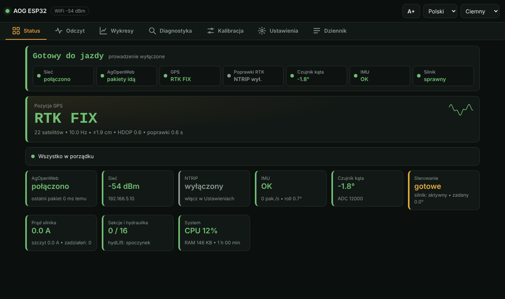</td>
<td valign="top">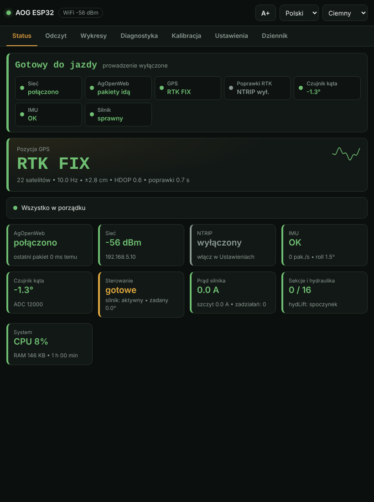</td>
<td valign="top">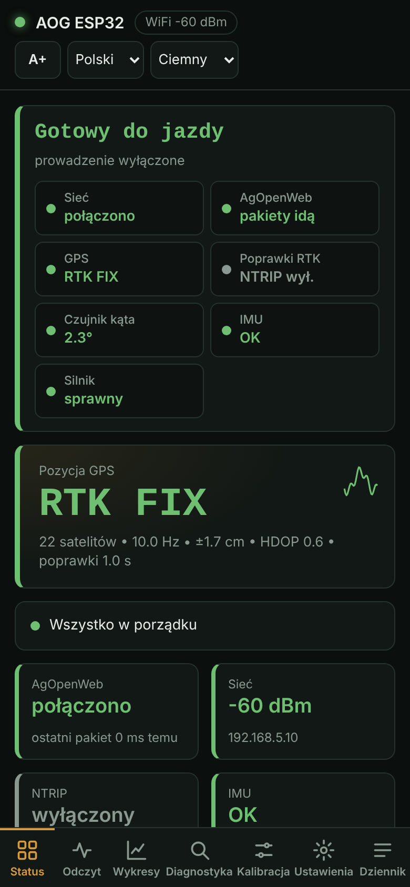</td>
</tr>
<tr><td colspan="3"><b>Odczyt</b></td></tr>
<tr>
<td valign="top">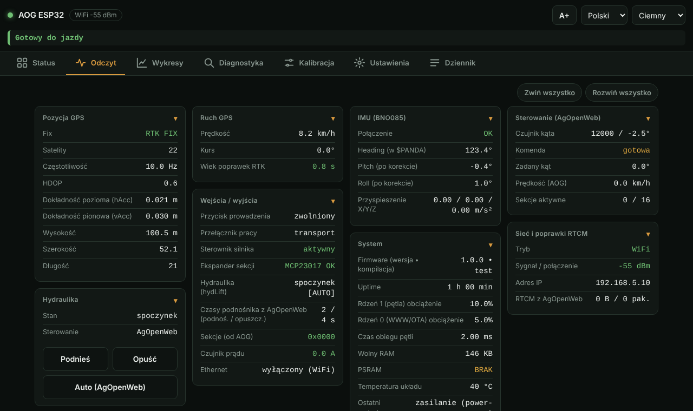</td>
<td valign="top">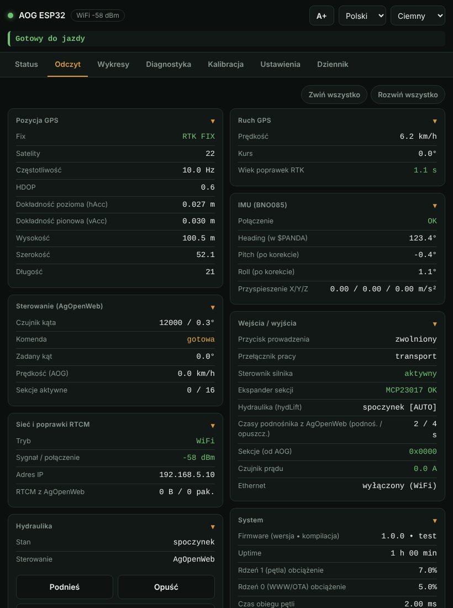</td>
<td valign="top">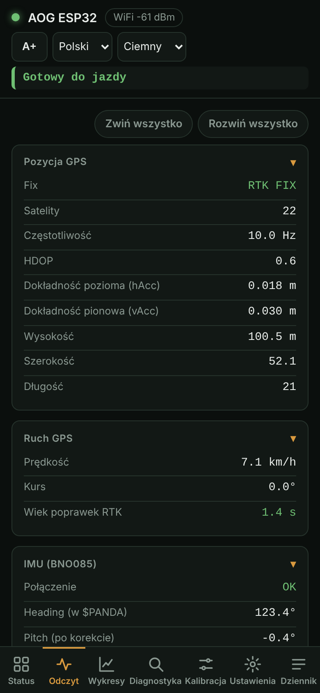</td>
</tr>
<tr><td colspan="3"><b>Wykresy</b></td></tr>
<tr>
<td valign="top">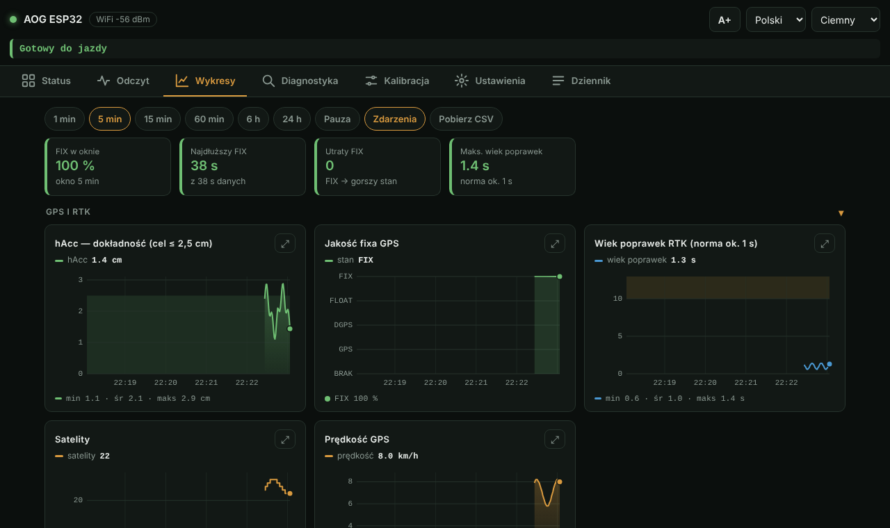</td>
<td valign="top">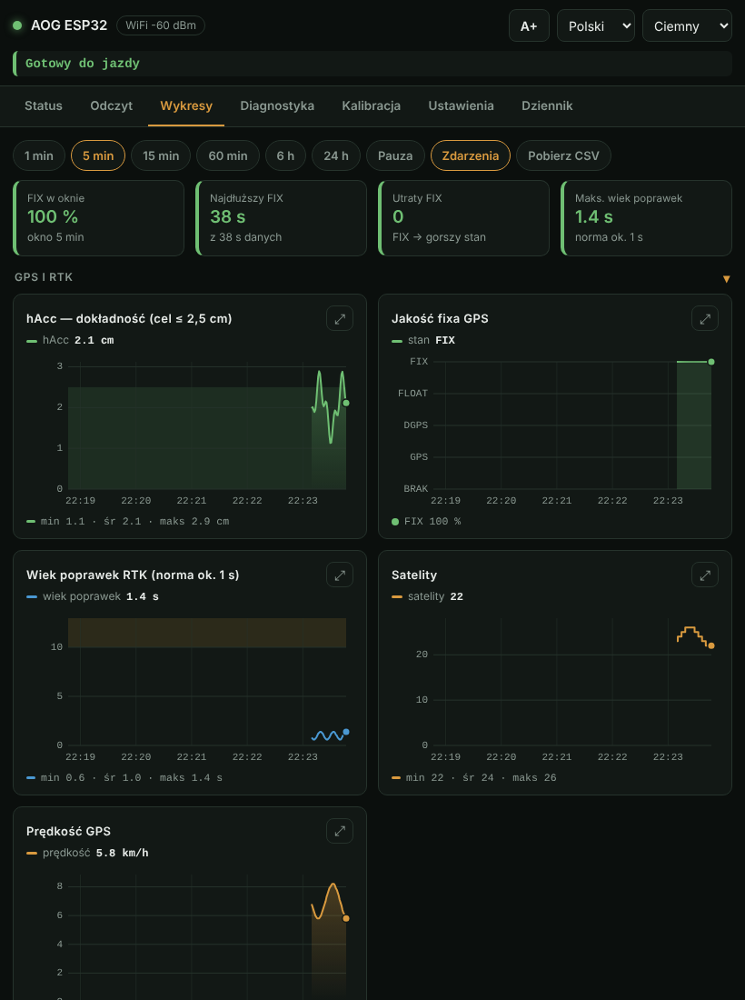</td>
<td valign="top">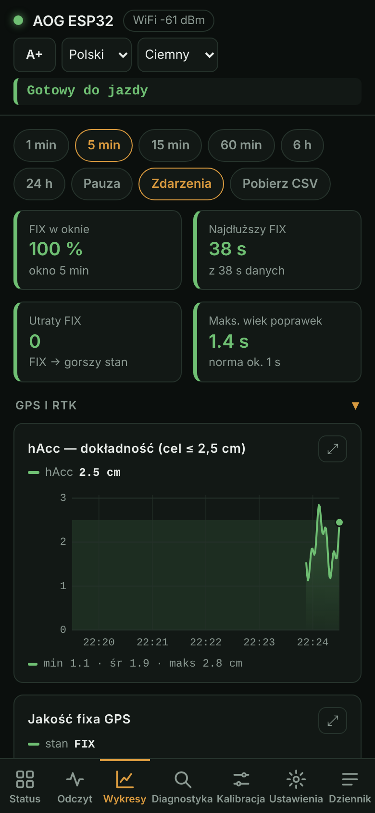</td>
</tr>
<tr><td colspan="3"><b>Kalibracja</b></td></tr>
<tr>
<td valign="top">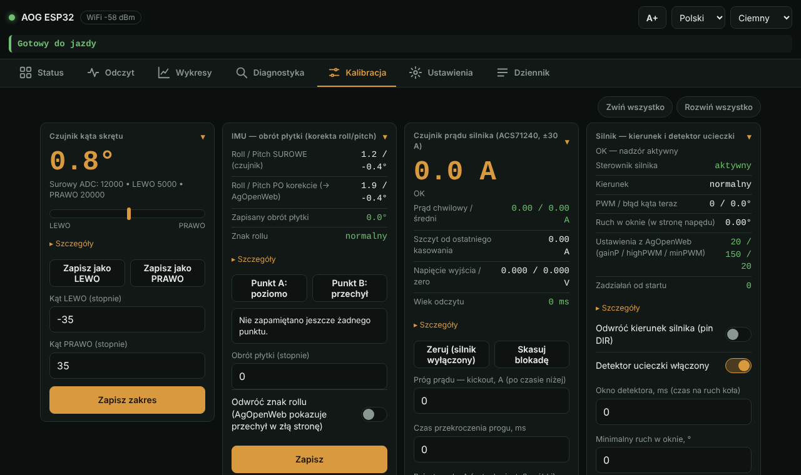</td>
<td valign="top">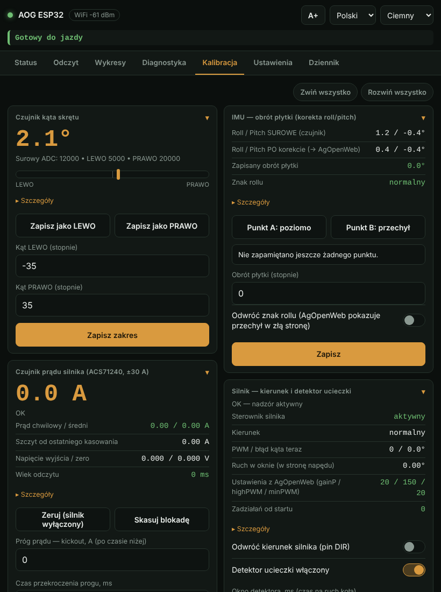</td>
<td valign="top">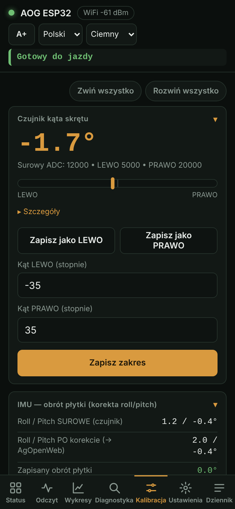</td>
</tr>
<tr><td colspan="3"><b>Ustawienia</b></td></tr>
<tr>
<td valign="top">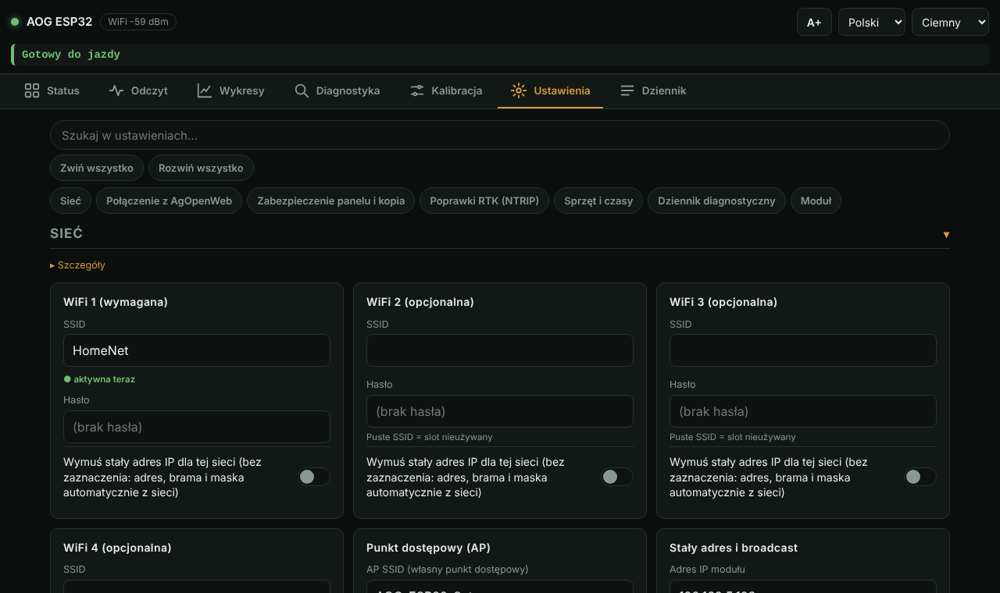</td>
<td valign="top">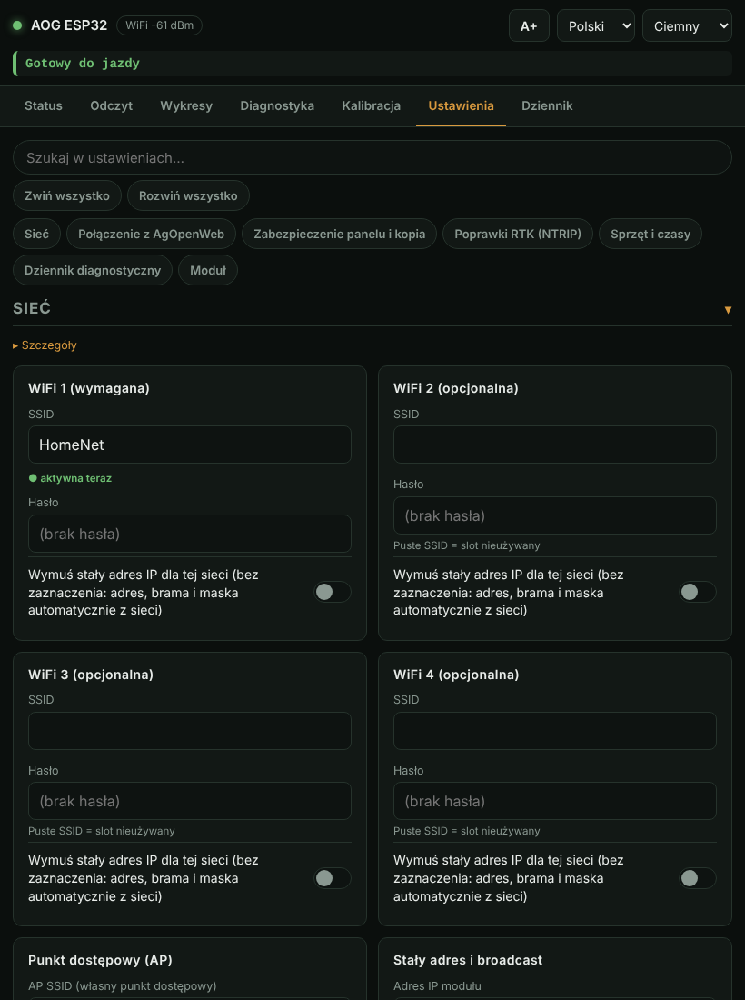</td>
<td valign="top">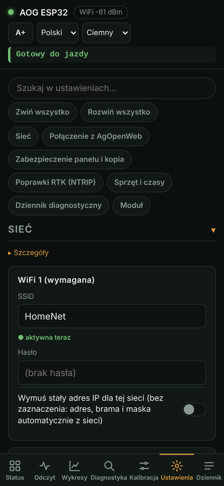</td>
</tr>
</table>

## Status

Pierwsza karta mówi, czy maszyna jest **gotowa do jazdy**, i wylicza, co jeszcze wymaga uwagi. Pod nią: duży fix
GPS/RTK i kafelki AgOpenWeb, sieci, NTRIP, IMU, czujnika kąta, sterowania, prądu silnika, sekcji i systemu.
Zielony = dobrze, bursztynowy = sprawdź, czerwony = problem.

## Odczyt

Wszystkie wartości na żywo w jednym miejscu: pozycja i dokładność GPS, prędkość i kurs, wejścia/wyjścia, IMU, dane
od AgOpenWeb (zadany kąt, prędkość, sekcje), sieć i RTCM, obciążenie i pamięć. Karta **Hydraulika** pokazuje stan podnośnika i kto
nim steruje (AgOpenWeb czy ręcznie) oraz ma przyciski Podnieś / Opuść / Auto. Podnieś i Opuść proszą o potwierdzenie;
Auto działa zawsze, a po restarcie zawsze wraca automat.

W Odczycie i Kalibracji kartę zwijasz dotknięciem jej tytułu; **Zwiń wszystko** / **Rozwiń wszystko** nad kartami robią to dla całej zakładki, a przeglądarka pamięta wybór. Długie objaśnienia wszędzie są schowane pod **Szczegóły**.

## Wykresy

Wykresy na żywo: jakość fixa, dokładność, wiek poprawek, satelity, prędkość, roll/pitch, kąt skrętu, prąd silnika, WiFi,
przepływ danych, CPU i RAM; zakresy od 1 minuty do 24 godzin, pauza, eksport CSV, wspólny kursor i pełny ekran. Moduł
sam trzyma historię (w PSRAM), więc wykresy wypełniają się także przy zamkniętej stronie; po restarcie zaczynają od nowa.
Wymaga to włączonego OPI PSRAM przy kompilacji. Pionowe linie to zdarzenia (zmiana fixa, włączenie/wyłączenie sterowania, restarty, utrata sieci).

## Diagnostyka

Jedna karta na podsystem. Przełącznik w karcie włącza logowanie tego podsystemu **i** pokazuje wszystkie jego dane
(wynik konfiguracji GPS, czasy zaników WiFi, trend wolnego RAM, liczniki PGN, ...). Użyj, gdy coś szwankuje. Włączone
karty ustawiają się na początku, po kolei, na samej górze.

Karta **System** trzyma też liczniki, które przeżywają restarty: starty, nienormalne restarty (awaria, watchdog, spadek
zasilania), czas pracy silnika i zadziałania zabezpieczeń (ucieczka, prąd, zawieszenie pętli odcięte zegarem bezpieczeństwa). Dwadzieścia sekund po każdym
starcie w dzienniku pojawia się jedna **linia autotestu** (czujnik kąta, IMU, ekspander sekcji, czujnik prądu, GPS, sieć:
OK / NO / off).

AgOpenWeb pokazuje też na ekranie krótkie komunikaty od modułu: nienormalny restart (raz, gdy AgOpenWeb słucha),
„Motor not armed - switch steering off and on” (po angielsku; powtarzany co 15 s, dopóki trwa) oraz awarie sprzętu.

## Kalibracja

**Czujnik kąta** (rób to z odłączonym silnikiem):
1. Skręć koła do oporu w lewo → **Zapisz jako LEWO**.
2. Skręć koła do oporu w prawo → **Zapisz jako PRAWO**.
3. Wpisz rzeczywiste kąty skrajne kół w stopniach i **Zapisz zakres**.

Silnik pozostaje zablokowany, dopóki **oba** punkty nie zostały zapisane przynajmniej raz (czujnik, który nigdy nie był kalibrowany, nie ma użytecznego kąta).
Ustawień kalibracji, silnika, ochrony prądowej, zakresu i funkcji nie można zmieniać przy włączonym prowadzeniu w AgOpenWeb -
panel odpowie „Prowadzenie jest włączone” - więc najpierw wyłącz prowadzenie.

**Obrót płytki IMU** (koryguje roll/pitch przy przechylonym montażu):
1. Zamontuj obudowę i ustaw maszynę poziomo → **Punkt A**.
2. Przechyl ją na bok o 10-15° wokół osi jazdy → **Punkt B**.
3. Wpisz kąt i **Zapisz**. Jeśli AgOpenWeb pokazuje przechył w złą stronę, zaznacz **Odwróć znak rollu** przed zapisem.

**Czujnik prądu silnika:** przy wyłączonym silniku i wyłączonym prowadzeniu naciśnij **Zeruj** (uśrednianie ok. 1-2 s).
Potem ustaw próg prądu (kickout), jego czas i próg twardy odpowiednio do silnika i **Zapisz progi**.

**Kierunek silnika i detektor ucieczki:** za pierwszym razem odłącz silnik od kierownicy albo unieś koła. Włącz
prowadzenie w AgOpenWeb z celem kilka stopni od aktualnego kąta. Jeśli koło idzie w złą stronę, detektor zatrzyma
silnik w ułamku sekundy; zaznacz **Odwróć kierunek silnika**, zapisz i powtórz. (Najpierw wyłącz prowadzenie: przy włączonym nie da się zapisać ustawień.) Nic nie trzeba przekompilowywać.

## Ustawienia

Zakładka jest podzielona na sekcje z tytułami - Sieć, Połączenie z AgOpenWeb, Zabezpieczenie panelu i kopia, Poprawki RTK
(NTRIP), Sprzęt i czasy, Dziennik diagnostyczny, Moduł - z przyciskami u góry do szybkiego przejścia. Długie opisy są
schowane pod „Szczegóły”. Na telefonie każdą sekcję można zwinąć dotknięciem tytułu, a otwarta na początku jest tylko pierwsza.

| Karta | Co robi |
|---|---|
| **Sieć** | do 4 sieci WiFi (puste hasło dozwolone), stały IP dla wybranej sieci, własny punkt dostępowy, adres broadcast AgOpenWeb. Wymaga restartu |
| **Nadawcy AgOpenWeb** | lista programów AgOpenWeb nadających w sieci. Moduł słucha jednego (pierwszego, który się odezwał) i ignoruje pozostałe; można przypiąć wybranego na stałe |
| **Odczyt włączenia prowadzenia** | który bit bajtu statusu oznacza „włączone” |
| **NTRIP** | host, port, mountpoint, użytkownik i hasło usługi poprawek; hasła nigdy nie wracają na stronę |
| **Funkcje** | włączanie i wyłączanie podsystemów (ekspander sekcji, silnik, czujnik prądu, IMU, LED). Podnośnik, tory i geo-stop nie są przełącznikami: to funkcje pinów wybierane w AgOpenWeb (Machine → Pin Config). Sterownik silnika i czujnik prądu działają od razu; ekspander sekcji, IMU i LED wymagają restartu |
| **Ethernet** | sieć przewodowa W5500 (po restarcie; bez łącza wraca na WiFi) |
| **Progi i czasy** | liczbowe ustawienia z walidacją |
| **Zabezpieczenie panelu** | PIN / hasło / brak |
| **Kopia zapasowa** | eksport ustawień do pliku i późniejszy import |
| **Restart / OTA / domyślne** | restart, strona wgrywania oprogramowania, reset fabryczny |

Ustawienia są zapisane w pamięci modułu i mają pierwszeństwo przed wartościami wkompilowanymi w oprogramowanie.

## Dziennik

Filtry (GPS, sieć, IMU, błędy, system), wyszukiwanie, pauza, kopiowanie i pobieranie. **Raport diagnostyczny** zapisuje
jeden plik tekstowy do zgłoszenia błędu: wersje, werdykt „gotowe do jazdy”, wszystkie bieżące wartości, ostatnie
zdarzenia i dziennik (bez haseł i tokenów).

## Kilka narzędzi naraz

- **Kilka programów AgOpenWeb w sieci:** moduł rozmawia tylko z pierwszym nadawcą; gdy słychać drugiego (np. telefon
  z AgOpenWeb w tle), **Status** pokazuje ostrzeżenie.
- **Kick-out:** gdy zadziała zabezpieczenie silnika (nadprąd, awaria czujnika prądu, detektor ucieczki), moduł wysyła
  PGN 250 = 255 przez 3 s. Żeby AgOpenWeb sam wyłączył prowadzenie, włącz tam *Konfiguracja AutoSteer → Czujnik prądu*
  i ustaw próg na 80-100 %. Ponowne włączenie zostaje po stronie operatora.
- **Hotspot z telefonu:** użyj [forka AgOpenWeb z poprawionym unicastem](https://github.com/kostek415contact-hash/AgOpenWeb) i wpisz jego nazwę i hasło w Ustawienia → Sieć; adres, maska i brama przychodzą z DHCP.
