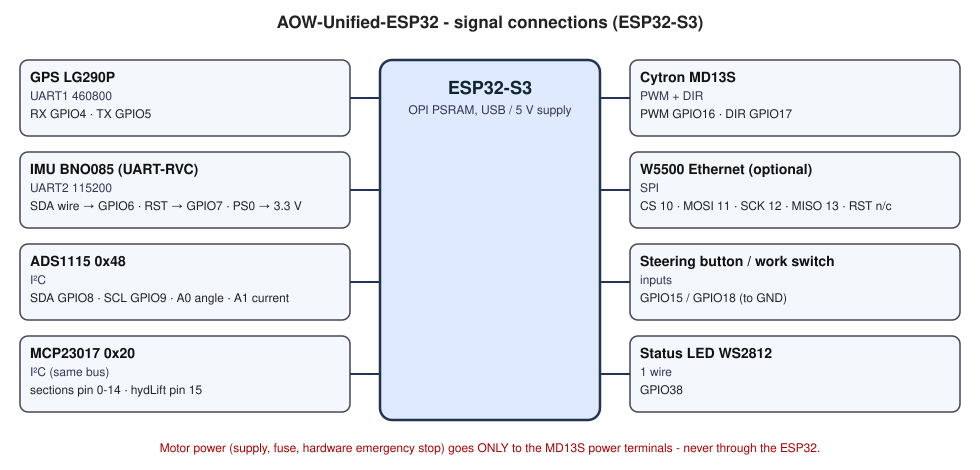

# Okablowanie i części

[English](../en/wiring.md) · [Tabela pinów](pinout.md) · [Powrót do README](../../README.pl.md)

> ⚠️ Ten moduł kieruje pojazdem. Najpierw przeczytaj [SAFETY.md](../../SAFETY.md). W linii zasilania silnika **musi** być
> bezpiecznik i **sprzętowy wyłącznik awaryjny**, który odcina zasilanie silnika niezależnie od oprogramowania.

Schemat wygenerowany przez AI na podstawie tabeli pinów.

## Lista części

| Część | Do czego |
|---|---|
| Płytka ESP32-S3 z **OPI PSRAM** | sam moduł (PSRAM trzyma log i 24-godzinną historię wykresów) |
| Odbiornik GNSS Quectel LG290P (+ antena) | pozycja, RTK |
| Płytka BNO085 | kurs/roll/pitch po UART-RVC |
| Płytka ADS1115 | 16-bitowy przetwornik dla czujnika kąta i czujnika prądu |
| Czujnik kąta skrętu (potencjometr lub czujnik Halla na osi skrętu) | kąt kół na kanał 0 ADS1115 |
| Czujnik prądu ACS71240KEXBLT-030B3 (±30 A) | prąd silnika na kanał 1 ADS1115 |
| Płytka MCP23017 | 16 wyjść: sekcje, podnośnik hydrauliczny, tory, geo-stop (wg ustawień w AgOpenWeb) |
| Sterownik silnika Cytron MD13S | napędza silnik kierownicy |
| Płytka Ethernet W5500 (opcja) | sieć przewodowa zamiast WiFi |
| Dioda WS2812, przycisk prowadzenia, przełącznik pracy | sygnalizacja i wejścia operatora |
| Bezpiecznik, sprzętowy wyłącznik awaryjny, przetwornica obniżająca | zasilanie (patrz niżej) |

## Zasilanie

- Płytka ESP32 i cała logika pracują ze **stabilnego 5 V** (zalecana przetwornica obniżająca z zasilania pojazdu).
  Słabe zasilanie z USB powodowało zawieszanie IMU w prototypie; zewnętrzna przetwornica to naprawiła.
- **Zasilanie silnika** (takie, jakiego wymaga silnik) idzie tylko na zaciski mocy MD13S, **przez bezpiecznik i wyłącznik
  awaryjny**. Masa wspólna z logiką.
- BNO085, ADS1115, MCP23017 i czujnik prądu zasilaj z **3,3 V**.
- GND / 5 V / 3,3 V rozłóż na kilka pinów listwy, nie na jeden.

## Uwagi do modułów

- **IMU BNO085:** tryb UART-RVC ustawia **PS0 połączone z 3,3 V** (przylutuj na stałe). Przewód SDA czujnika niesie dane
  UART na **GPIO6**. RST na GPIO7 pozwala modułowi zresetować czujnik z panelu.
- **Czujnik kąta:** wyjście czujnika na **A0** ADS1115. Skrajne położenia lewo/prawo kalibrujesz w panelu
  (zakładka **Kalibracja**) - patrz [instrukcja](user-guide.md).
- **Czujnik prądu:** wyjście na **A1** ADS1115, zasilanie 3,3 V. Po podłączeniu wykonaj kalibrację zera (silnik wyłączony).
- **Ethernet W5500:** RST zostaw celowo niepodłączony (patrz [piny](pinout.md)). Włącz w panelu (**Ustawienia → Ethernet**) i zrestartuj.
- **Przyciski:** przycisk prowadzenia na GPIO15 i przełącznik pracy na GPIO18 łączą pin z **GND** po wciśnięciu/aktywacji
  (używane są wewnętrzne podciągnięcia).
- **Sekcje:** piny 0-15 MCP23017; funkcję każdego wyznacza Pin Config z AgOpenWeb (domyślnie Sec1-16 na pinach 0-15). Użyj przekaźników/driverów dobranych do obciążeń -
  wyjścia MCP23017 są tylko logiczne.
